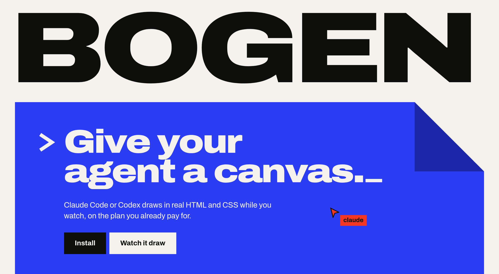
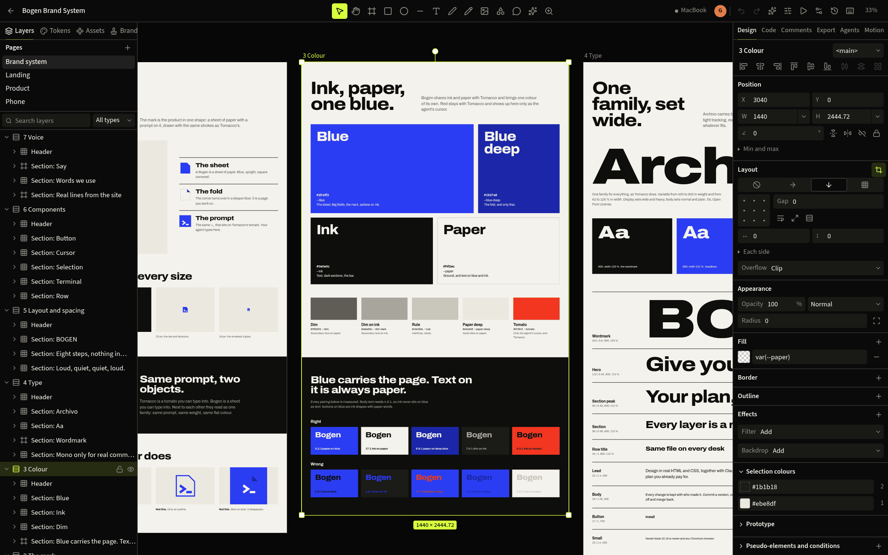

<p align="center">
  
</p>

# Bogen for macOS

<a href="https://github.com/marselnenaj/bogen/releases/latest"></a>

Design websites, app interfaces, brands and Mac themes with your own coding agent. Bogen gives Claude Code, Codex and OpenCode an editable canvas made of real HTML and CSS: the layout you see, the agent's screenshots and the exported design use the same rendering engine.

This repository contains the Mac app, its source and its distribution tooling. It shares its design engine and `.bogen` format with [Bogen for Omarchy](https://github.com/marselnenaj/bogen).

**Free and open source, like Bogen for Omarchy.** No account, no activation, nothing locked. Agent usage stays on your own provider plan; Bogen includes no model credits.

[Build the app](#build-on-a-mac) · [Current status](#current-status) · [Updates](#updates) · [User guide](docs/guide/README.md) · [Mac architecture](docs/macos/adr-0001-app-runtime.md)

## The Mac app

Open Bogen from Finder or the Dock. It has its own window, menus and settings, a menu bar icon, opens `.bogen` documents and Bogen links, and manages its local server. The packaged app includes Node.js and a headless Chromium for screenshots and exports; neither needs a separate install.

Your designs live in `~/Library/Application Support/Bogen`. There is no Bogen account or hosted design cloud. Sync to your own devices over Tailscale is optional; the Mac app uses the same documents as the Omarchy edition.

| Design workflow | What Bogen provides |
| --- | --- |
| Websites and app interfaces | Editable frames, flex and grid, responsive sizes, text, vectors, tokens, components and interactive previews. Bogen designs interfaces; [Tomacco](docs/guide/tomacco.md) handles building and testing mobile apps. |
| Your own agents | Connect Claude Code, Codex or OpenCode in Settings, ask in the chat beside the canvas or in a comment thread, inspect progress, stop a run and review proposals. Replies keep their agent context; only the user resolves a thread. Install and sign in to the agent CLI separately. |
| Speak instead of typing | The microphone in the chat and comment boxes; a local speech model (whisper.cpp from Homebrew) writes it out on this Mac and nothing goes online. macOS asks once for the microphone; Bogen never asks for the camera. |
| Fonts, kits and code | Agents draw fonts of their own and build OTF and WOFF2 files. Kits for shadcn, Mantine, Carbon, USWDS, daisyUI, Web Awesome and Pico CSS; icons from Lucide, Phosphor, Tabler, Heroicons and Material Symbols; code as React, Tailwind, Vue, Svelte and SwiftUI. |
| Accessibility and legal check | A page checked against EN 301 549, WCAG 2.2 AA, the European Accessibility Act with Austria's BaFG, or the WZG, criterion by criterion with axe-core, plus an accessibility statement draft. A technical aid, not legal advice. |
| Brands | Keep logos, colours, typography and rules together. Extract suggestions from an existing website, CSS or design; review them before they become binding brand rules. |
| Mac themes | Two separate scopes: a **desktop appearance** (wallpapers for your Mac's displays in light and/or dark, a palette, illustrative previews) and an **appearance kit for your own apps** (semantic colours for light and dark, type, spacing). Export a data-only zip with PNG wallpapers, a versioned manifest, CSS and JSON tokens and an Xcode colour catalog. Bogen does not change your Mac: you set the wallpaper, appearance and accent in System Settings, and the menu bar, Dock and windows in the previews are illustrations. One Mac theme is one file: asking an agent for the same theme again reopens it, ambiguous requests ask you which one, and only **New** on Home (or an explicit request for a separate theme) makes another. See [Mac themes](docs/guide/mac-themes.md). |
| Menu bar | Bogen's mark as a native template icon: open Bogen, start a design, see whether the server runs and which agents are working, Settings and Quit. It can be hidden in Settings; Bogen stays in the Dock. |
| Omarchy theme files | Theme files made for Omarchy Linux open with their format intact and are labelled as Omarchy themes. Existing synced files are listed under **Other devices** while present. Home and new-file kind menus offer Mac themes on this computer; install and apply Omarchy themes on an Omarchy device. |
| A canvas that fits | Responsive panels and dialogs, plus **Fit screen** (`Shift+3`), **Fit width** (`Shift+4`) and **All screens** (`Shift+1`), so fitting the design does not require repeated mouse zooming. |
| Export | Images, SVG, PDF, video, HTML, React and Tailwind output from the same design. |
| Versions | History, checkpoints, revisions and proposals let you improve existing work without accumulating new pages and copies. **Branches** keep alternatives of a whole design inside the same file (the branch menu next to the file name); agents can start one, and only you merge or discard it. |
| Languages | The editor, Home and phone app are available in Omarchy's 50 languages (English plus 49 translations, chosen in Settings or automatically). Translations are machine-made and have not been reviewed by native speakers. The Mac app's own window chrome, menus, Settings, Help, dialogs and menu bar icon menu are still English. |
| Your devices | Opt-in Tailscale sync between your own computers, with phone access through a paired host. Folder organisation is currently per device. |



*The shared editor, captured on Omarchy. This illustrates the design canvas, not the native Mac window chrome.*

OpenCode supports canvas requests without image attachments, live projects or an effort setting. Grok, Hermes and Oh My Pi connect as external MCP clients; Bogen does not start them internally. See the [agent support matrix](docs/guide/agents.md#which-agents-bogen-runs).

## Current status

**Version 0.4.2** is built with Developer ID signing, notarization and stapling for Apple Silicon and Intel, and
reaches installed apps through the signed in-app updater from `https://bogen.dev/updates/macos/`. Install a first
signed DMG manually to join the update channel; development builds cannot bootstrap into it. Each signed build runs
the app and update tests, signature and entitlement checks, Apple's notarization and Gatekeeper's assessment; the
arm64 bundle also runs its server and makes a real render. Intel receives structural verification on the arm64
runner. The target is macOS 13 or later.

The app includes Mac themes, the Bogen menu bar icon, the 50-language editor, branches inside a file and one-project-per-theme reuse for Mac and Omarchy themes. Their automated tests cover menu contents, one status item for the app's life, bounded status checks, quit cleanup, the template image, theme creation, export round trip, host guards and Omarchy file preservation. A separate sandboxed browser check passed the Home → Mac theme → export flow at desktop and narrow window sizes. The manual [menu bar and Mac theme checks](docs/macos/smoke-checklist.md#menu-bar-icon), including light/dark tint, VoiceOver and Xcode import, remain open.

The app includes the design-content-language controls and the additional runner support. OpenCode invocation, settings, MCP lifecycle and cancellation are covered by stand-in CLIs on the native Mac runner; no real OpenCode, Grok, Hermes or Oh My Pi provider session has been tested. A file can keep its own content language, a request can override it, and a translated version stays in a branch of the same file. See [Screens in another language](docs/guide/agents.md#screens-in-another-language).

Large-file rendering and memory-pressure handling are included in the test gate. This is evidence for the tested fixtures, not a guarantee for every document or Mac.

Theme alternatives stay in branches of their project. Agent creation tools refuse renamed copies during an edit or redo and from a branch, including after a document leaves memory or someone else switches the file to Main; deliberately opening Main moves that session onto it. Older duplicate files have a reviewed consolidation flow with backups; they are not silently deleted. A streamlined prompt-first Home and URL-to-brand workflow is being planned; the existing brand extraction tools are already available.

The signed OTA archives and metadata are served from a separate HTTPS feed.

## Build on a Mac

A source build needs Git, Node.js 22.18 or newer, npm and Apple's command-line developer tools. Start from this repository:

```sh
git clone https://github.com/marselnenaj/bogen-macos.git
cd bogen-macos
npm ci
npm run build

cd apps/macos
npm ci
node scripts/fetch-runtime.mjs --arch arm64 --frozen
node scripts/package.mjs --arch arm64
node scripts/verify-app.mjs --app release/dev/arm64/Bogen.app --gui
node scripts/make-dmg.mjs --arch arm64
```

Use `--arch x64` for an Intel package. Functional checks must run on the matching architecture. Packaging and signing require macOS; Linux can typecheck, build the editor/server and run the supported tests.

For a native build on GitHub's Macs, run **macOS validation** in this repository's [Actions](https://github.com/marselnenaj/bogen-macos/actions/workflows/macos.yml). The workflow uses pinned runtimes and offline agent stand-ins; it does not publish a release or use production signing credentials.

[Building and runtime pins](docs/macos/building.md) · [Smoke checklist](docs/macos/smoke-checklist.md) · [Distribution and signing](docs/macos/distribution.md)

## Updates

Signed releases use the HTTPS feed at `https://bogen.dev/updates/macos/`. The first signed app must be installed manually from its DMG; subsequent higher versions can use the in-app updater. Existing development builds still require a new download.

A release build checks the public HTTPS feed, verifies an Ed25519-signed manifest and checks the download's size, hash, architecture and minimum macOS version. Installation requires the user's click and a restart; the app does not silently install updates. Squirrel.Mac also checks the app's signing identity.

The update feed is separate from GitHub and the app carries no GitHub token. The CLI's npm updater refuses to replace an app bundle. See [Updates](docs/macos/distribution.md#updates) for the exact flow and release requirements.

## Privacy and architecture

The Electron renderer is sandboxed and context-isolated, with Node integration off. The backend binds to loopback; external links open in the system browser. Agent CLIs run only when requested, through the user's own installation. Bogen sends no usage telemetry or automatic crash reports.

The app bundles Electron, Node.js and a headless Chromium, so a desktop app build is larger than the Omarchy command-line package. Their versions and hashes are pinned in [runtime.json](apps/macos/runtime.json). The app manages the server and background renderer lifecycle; quitting the app does not leave them running.

[Mac security model](docs/macos/security.md) · [Privacy](docs/guide/privacy.md) · [Licence and product](docs/macos/product.md) · [Architecture decision](docs/macos/adr-0001-app-runtime.md)

## Documentation

- [Canvas, layout and responsive design](docs/guide/canvas.md)
- [Agents, threads and proposals](docs/guide/agents.md)
- [Brands and source extraction](docs/guide/brand.md)
- [Capture and Figma import](docs/guide/capture-and-import.md)
- [Theme design and export](docs/guide/omarchy.md)
- [Device sync and phone access](docs/guide/devices.md)
- [Export and code](docs/guide/export-and-code.md)
- [History and revisions](docs/guide/history.md)
- [Troubleshooting](docs/guide/troubleshooting.md)

## License and acknowledgements

Bogen for macOS, the Mac app and the design engine, is free software licensed under GPL-3.0-or-later; see [LICENSE](LICENSE). The code Bogen writes into your exports is yours under any terms you choose; see [LICENSE-EXCEPTION.md](LICENSE-EXCEPTION.md). Earlier MIT notices remain applicable to their respective code. The bundled theme artwork is CC0-1.0; see [ASSET_PROVENANCE.md](ASSET_PROVENANCE.md). Third-party packages retain their licenses and notices in [THIRD_PARTY_NOTICES.md](THIRD_PARTY_NOTICES.md).

Bogen is independent of Omarchy, Figma and Paper. The implementation uses web standards, public documentation and permissively licensed dependencies; Paper Desktop and OpenPaper code are not used. See [SECURITY.md](SECURITY.md) for private vulnerability reports and [CONTRIBUTING.md](CONTRIBUTING.md) for development conventions.

Copyright © 2026 Marsel Nenaj and Bogen contributors.
